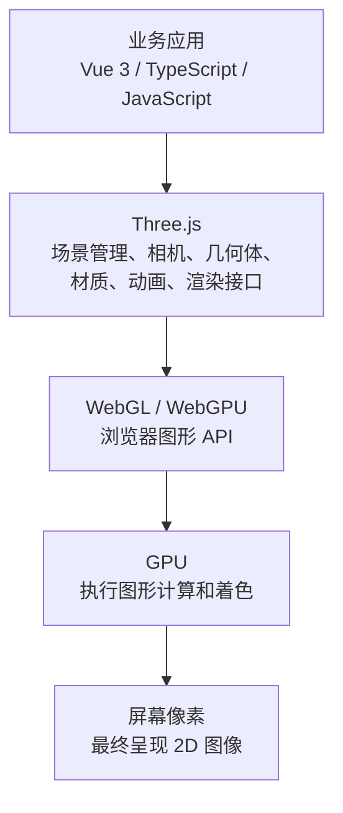

# D01：认识 Three.js

> WebGL 与 Three.js 的关系，以及 Web 3D 渲染的基本原理

| 项目 | 说明 |
| --- | --- |
| 预计学习时间 | 30 分钟 |
| 课程难度 | 入门基础 |
| 开发环境 | Vue 3 + TypeScript + Vite；Mac / Windows 双平台 |

---

## 导读

今天我们先不急着写复杂代码。

我希望你先建立一个正确的认知：

**Three.js 不只是一个用 JavaScript 创建 3D 模型的库，而是一套帮助开发者管理三维场景、组织图形数据、控制相机、材质、光照并驱动 GPU 渲染的 3D 图形引擎。**

理解这一点，会让你后面学习 168 天的内容更加顺畅。

---

## 1. 学习目标

今天完成后，你应该能够回答：

1. 什么是 3D 图形学？
2. WebGL 是什么？它在浏览器中扮演什么角色？
3. Three.js 和 WebGL 有什么区别？
4. Three.js 的渲染过程是什么？
5. Three.js、WebGL、GPU 三者之间是什么关系？
6. 为什么前端开发需要学习 Three.js？

---

## 2. 基础概念讲解

### 2.1 什么是 3D 图形学？

先从一个简单的问题开始：我们平时开发 Vue 页面时，浏览器展示的是什么？

例如：

```html
<div class="box">
  Hello Three.js
</div>
```

浏览器会把 HTML 转换成 DOM，把 CSS 转换成样式规则，然后通过布局、绘制和合成等流程，将内容显示在屏幕上。

这属于传统的 Web 页面渲染。

但如果我们要在网页中创建：

- 一个立体的建筑物
- 一辆可以旋转的汽车
- 一个可以自由观察的三维园区
- 一个人体模型
- 一个具有真实光照和阴影的工厂

事情就不一样了。我们需要处理：

- 三维空间中的位置
- 物体的几何结构
- 相机的观察方向
- 光线与物体表面的关系
- 材质和纹理
- 物体之间的遮挡关系
- 最终如何把三维场景转换为二维屏幕图像

这就是计算机图形学（Computer Graphics）所研究的核心问题之一。

#### 一个重要概念：3D 世界最终仍然显示在 2D 屏幕上

假设我们创建一个三维立方体：

```js
const geometry = new THREE.BoxGeometry(2, 2, 2)
const material = new THREE.MeshStandardMaterial({
  color: 0x00aaff
})

const cube = new THREE.Mesh(geometry, material)
scene.add(cube)
```

这个立方体在程序中具有三维空间属性：

```text
P = (x, y, z)
```

但你的显示器只有二维像素：

```text
Pixel = (x, y)
```

所以 Three.js 必须通过一系列数学计算，把三维空间中的物体转换为屏幕上的二维图像。

这个过程叫作 **3D 渲染（Rendering）**。

这也是我们后续要学习相机、矩阵、投影和 Shader 的原因。

### 2.2 什么是 WebGL？

| 名称 | 全称 | 定位 |
| --- | --- | --- |
| WebGL | Web Graphics Library | 浏览器提供的底层 3D 图形编程接口 |

简单理解：

**WebGL 是浏览器提供的一套接口，让 JavaScript 能够控制 GPU 进行图形渲染。**

它允许我们：

- 创建 GPU 缓冲区
- 上传顶点数据
- 编写 GLSL Shader
- 创建纹理
- 配置渲染状态
- 调用 GPU 绘制图形

例如，如果不使用 Three.js，想通过原生 WebGL 绘制一个三角形，我们需要做很多事情：

1. 获取 WebGL 上下文
2. 创建顶点着色器
3. 创建片元着色器
4. 编译 Shader
5. 创建 GPU Buffer
6. 将顶点数据上传到 GPU
7. 设置顶点属性
8. 配置绘制状态
9. 执行绘制命令

这意味着即使只想画一个简单的三角形，也需要编写不少底层代码。

WebGL 的能力很强，但使用门槛相对较高。

### 2.3 什么是 Three.js？

| 名称 | 全称 | 定位 |
| --- | --- | --- |
| Three.js | JavaScript 3D Library | 用于构建 Web 3D 场景的图形库 |

Three.js 的核心价值是：

**将复杂的底层图形操作封装成更容易使用的 JavaScript API。**

例如，使用 Three.js 创建一个立方体：

```js
import * as THREE from 'three'

// 1. 创建场景
const scene = new THREE.Scene()

// 2. 创建相机
const camera = new THREE.PerspectiveCamera(
  75,
  window.innerWidth / window.innerHeight,
  0.1,
  1000
)

// 3. 创建渲染器
const renderer = new THREE.WebGLRenderer()
renderer.setSize(window.innerWidth, window.innerHeight)

// 4. 创建几何体
const geometry = new THREE.BoxGeometry(1, 1, 1)

// 5. 创建材质
const material = new THREE.MeshBasicMaterial({
  color: 0x00aaff
})

// 6. 创建网格对象
const cube = new THREE.Mesh(geometry, material)

// 7. 添加到场景
scene.add(cube)

// 8. 设置相机位置
camera.position.z = 5

// 9. 执行渲染
renderer.render(scene, camera)
```

你会发现，我们不需要自己编写完整的 WebGL Shader，也不需要手动创建底层顶点缓冲区——Three.js 帮我们完成了大量工作。

当然，这不意味着 Three.js 不需要图形学知识。恰恰相反，越复杂的场景，越需要理解它背后的原理。

---

## 3. Three.js、WebGL、GPU 的关系

这是今天最重要的知识点。

### 3.1 Web 3D 技术分层



### 3.2 容易产生的误解

需要纠正一个常见误解：

**Three.js 并不等于 WebGL，WebGL 也不等于 GPU。**

| 技术 | 职责 | 类比 |
| --- | --- | --- |
| Vue 3 | 组织业务界面 | 应用程序 |
| Three.js | 管理 3D 场景和渲染对象 | 3D 引擎 |
| WebGL | 提供浏览器图形接口 | 硬件操作接口 |
| GPU | 执行图形计算 | 图形计算设备 |

另外，Three.js 现在也有 WebGPU 渲染体系，所以未来我们还会学习 WebGPU 和 TSL。

---

## 4. 底层原理：一个 3D 场景是如何被渲染出来的？

现在我们进入稍微深入一点的内容。

假设你在 Three.js 中创建了一个建筑物，它是如何最终出现在浏览器里的？

可以把过程理解成以下六个步骤。

### 4.1 第一步：创建三维模型

模型首先需要有几何结构。例如一个立方体：

- 8 个几何顶点
- 12 个三角形面
- 每个顶点有对应的空间坐标

注意：实际 Three.js 的 `BoxGeometry` 会根据面片的法线和 UV 等属性组织顶点数据，顶点数组中的顶点数量不一定就是 8。

### 4.2 第二步：进行模型变换

物体可能需要：

- 移动
- 旋转
- 缩放

这些操作会通过矩阵变换实现。例如：

```js
cube.position.set(2, 1, 0)
cube.rotation.y = Math.PI / 4
cube.scale.set(2, 2, 2)
```

这里你已经接触到了三个非常重要的属性：

- `position`：位置
- `rotation`：旋转
- `scale`：缩放

后面的第 3 周我们会深入研究矩阵、欧拉角和四元数。

### 4.3 第三步：相机观察场景

3D 场景不是直接显示在屏幕上的，我们需要一台虚拟相机。

相机决定：

- 从哪里观察
- 朝哪个方向观察
- 观察范围有多大
- 使用透视投影还是正交投影

这也解释了为什么同一个物体，切换相机后看起来会完全不同。

### 4.4 第四步：投影转换

相机需要将三维空间中的物体投影到二维平面。这里涉及：

- Model Matrix
- View Matrix
- Projection Matrix

这是后面学习 `Matrix4` 的重要基础。

### 4.5 第五步：GPU 执行渲染

Three.js 会通过底层图形接口提交渲染工作。

GPU 根据顶点数据和 Shader 等执行相应的图形计算，生成片元，并进行深度测试、混合等处理。

### 4.6 第六步：显示最终图像

渲染结果进入浏览器的图形合成流程，最终呈现在你的屏幕上。

今天不需要记住所有细节，只需要理解这个整体过程。

---

## 5. 核心 API 预览

今天先认识 Three.js 最重要的三个对象。

| 对象 | 职责 |
| --- | --- |
| Scene（场景） | 整个 3D 世界的容器；管理模型、灯光、辅助对象等 |
| Camera（相机） | 决定如何观察 3D 世界；控制视角、投影和观察范围 |
| Renderer（渲染器） | 负责将场景渲染成图像；负责与底层图形 API 交互 |

先记住这个关系：

```js
renderer.render(scene, camera)
```

这行代码是 Three.js 最核心的渲染入口之一。它的含义是：

> 使用指定的相机，观察指定的场景，然后把渲染结果输出到渲染器的画布上。

其他参数和内部工作，我们会在后续课程中逐步拆解。

---

## 6. 实战代码：创建第一个 Three.js 场景

今天的实践目标很简单：在浏览器中渲染一个真正的 3D 立方体。

### 6.1 安装依赖

先在已有 Vite + Vue 3 + TypeScript 项目中安装 Three.js：

```bash
npm install three
```

Three.js 自身已经提供 TypeScript 类型声明，不需要额外安装 `@types/three`。

### 6.2 完整示例

然后修改 `src/App.vue`：

```vue
<script setup lang="ts">
import { onMounted, onBeforeUnmount, ref } from 'vue'
import * as THREE from 'three'

const container = ref<HTMLDivElement | null>(null)

let scene: THREE.Scene | null = null
let camera: THREE.PerspectiveCamera | null = null
let renderer: THREE.WebGLRenderer | null = null
let cube: THREE.Mesh | null = null

let animationId = 0

function initThree() {
  if (!container.value) return

  // 1. 创建场景
  scene = new THREE.Scene()
  scene.background = new THREE.Color(0x18202b)

  // 2. 创建相机
  camera = new THREE.PerspectiveCamera(
    60,
    container.value.clientWidth / container.value.clientHeight,
    0.1,
    100
  )
  camera.position.set(0, 0, 5)

  // 3. 创建渲染器
  renderer = new THREE.WebGLRenderer({
    antialias: true
  })
  renderer.setSize(
    container.value.clientWidth,
    container.value.clientHeight
  )
  renderer.setPixelRatio(Math.min(window.devicePixelRatio, 2))
  container.value.appendChild(renderer.domElement)

  // 4. 创建几何体
  const geometry = new THREE.BoxGeometry(1.5, 1.5, 1.5)

  // 5. 创建材质
  const material = new THREE.MeshBasicMaterial({
    color: 0x00aaff
  })

  // 6. 创建网格对象
  cube = new THREE.Mesh(geometry, material)

  // 7. 添加到场景
  scene.add(cube)

  // 8. 开始渲染
  animate()
}

function animate() {
  if (!renderer || !scene || !camera || !cube) return

  animationId = requestAnimationFrame(animate)

  cube.rotation.x += 0.01
  cube.rotation.y += 0.01

  renderer.render(scene, camera)
}

function handleResize() {
  if (!container.value || !camera || !renderer) return

  const width = container.value.clientWidth
  const height = container.value.clientHeight
  if (!width || !height) return

  camera.aspect = width / height
  camera.updateProjectionMatrix()
  renderer.setSize(width, height)
}

onMounted(() => {
  initThree()
  window.addEventListener('resize', handleResize)
})

onBeforeUnmount(() => {
  window.removeEventListener('resize', handleResize)
  cancelAnimationFrame(animationId)

  if (cube) {
    cube.geometry.dispose()
    const material = cube.material
    material.dispose()
    scene?.remove(cube)
  }

  renderer?.dispose()
  renderer?.domElement.remove()

  renderer = null
  scene = null
  camera = null
  cube = null
})
</script>

<template>
  <div ref="container" class="three-container"></div>
</template>

<style scoped>
.three-container {
  width: 100%;
  height: 500px;
  overflow: hidden;
}

.three-container :deep(canvas) {
  display: block;
  width: 100%;
  height: 100%;
}
</style>
```

### 6.3 代码逐段解析

#### 1）创建 Scene

```js
scene = new THREE.Scene()
```

Scene 是场景的根对象。你可以把它理解成一个 3D 世界的容器，所有需要参与场景渲染的物体通常都需要加入场景图。

#### 2）创建 Camera

```js
camera = new THREE.PerspectiveCamera(
  60,
  width / height,
  0.1,
  100
)
```

这里先认识四个参数：

| 参数 | 含义 |
| --- | --- |
| `60` | 视野角度 FOV |
| `width / height` | 相机宽高比 |
| `0.1` | 近裁剪面 |
| `100` | 远裁剪面 |

这些参数我们在 D08–D12 会深入学习。

#### 3）创建 Renderer

```js
renderer = new THREE.WebGLRenderer({
  antialias: true
})
```

这里创建 WebGL 渲染器。`antialias: true` 表示开启抗锯齿，让物体边缘看起来更加平滑。

#### 4）创建 Geometry

```js
const geometry = new THREE.BoxGeometry(1.5, 1.5, 1.5)
```

Geometry 决定物体的几何形状。这里创建一个长、宽、高均为 1.5 个世界单位的立方体。

#### 5）创建 Material

```js
const material = new THREE.MeshBasicMaterial({
  color: 0x00aaff
})
```

Material 决定物体的外观。今天使用 `MeshBasicMaterial`，因为它不依赖场景灯光，方便我们先观察几何体。

#### 6）创建 Mesh

```js
cube = new THREE.Mesh(geometry, material)
```

Mesh 是几何体和材质的组合。可以先记住：

```text
Mesh = Geometry + Material
```

#### 7）渲染场景

```js
renderer.render(scene, camera)
```

告诉渲染器使用相机观察场景并输出画面。

#### 8）动画循环

```js
animationId = requestAnimationFrame(animate)
```

浏览器会在下一次绘制时机调用动画函数。

今天我们直接让立方体旋转。后面会进一步学习为什么动画应该使用 DeltaTime，而不是固定增加旋转角度。

### 6.4 工程化细节

代码中还包含两个工程化细节：

- `handleResize()`：容器尺寸变化时，更新相机宽高比和渲染器尺寸
- `onBeforeUnmount()`：组件销毁时释放几何体、材质和渲染器，避免资源泄漏

这两个细节在真正的 Vue 3 项目中非常重要。

---

## 7. 常见问题与误区

### 问题一：Three.js 是不是 WebGL 的替代品？

不是。

Three.js 是建立在底层图形 API 之上的高级图形库。它减少了大量底层操作，但并没有消除 WebGL 的概念。

### 问题二：Three.js 创建的场景是真正的 3D 吗？

是的。

只要场景中使用了三维几何结构、空间变换和三维相机进行渲染，就属于真正的三维场景。

即使使用 `OrthographicCamera`（正交相机），也不会因此变成 2D 场景。

这与你之前研究的正交等距轴数字孪生场景直接相关。

### 问题三：是不是 Three.js 所有计算都在 GPU 上执行？

不是。通常可以这样理解：

- **CPU**：组织场景、管理对象、执行 JavaScript 逻辑、准备渲染数据
- **GPU**：执行大量图形相关计算，例如顶点处理、片元着色等

所以一个复杂 Three.js 项目既可能遇到 CPU 瓶颈，也可能遇到 GPU 瓶颈。

### 问题四：Three.js 是不是只能用 WebGL？

不是。

Three.js 也在发展 WebGPU 渲染体系。两套体系的 API、底层机制和兼容性有所区别，我们会在 D145 专门学习。

### 问题五：为什么不能只学 Three.js API？

因为 API 只是工具。例如，你可以调用：

```js
object.position.set(10, 0, 0)
```

但如果不知道局部坐标和世界坐标的区别，就可能无法正确处理父子模型的移动。

因此，我们必须同时学习数学和图形学原理。

---

## 8. 今日练习与验收

今天的任务分为理论和代码两部分。

### 8.1 D01 理论小测

共 5 道题。

#### 1. Three.js 与 WebGL 的关系是什么？

- A. Three.js 是 WebGL 的替代品
- B. Three.js 是对底层图形能力的高级封装
- C. WebGL 是 Three.js 的一个组件

#### 2. Three.js 中负责管理 3D 世界的对象是什么？

- A. Camera
- B. Renderer
- C. Scene

#### 3. `renderer.render(scene, camera)` 的作用是什么？

- A. 创建模型
- B. 使用指定相机渲染场景
- C. 启动动画循环

#### 4. Mesh 通常由什么组成？

- A. Camera + Scene
- B. Geometry + Material
- C. Renderer + WebGL

#### 5. Three.js 中的正交相机是否仍然属于真正的 3D 场景？

- A. 是
- B. 不是

请提交答案。

### 8.2 实战任务：修改今天的立方体

请在代码中完成以下 4 个小任务：

1. 修改立方体颜色，尝试红色、绿色和紫色
2. 修改立方体大小，例如 `BoxGeometry(2, 1, 3)`
3. 修改相机位置，观察不同角度下的立方体
4. 修改旋转速度，观察动画变化

### 8.3 今日最终验收标准

完成 D01，需要满足：

- 能够独立创建 Scene、Camera、Renderer
- 能够解释 Three.js 和 WebGL 的关系
- 能够解释 Geometry、Material、Mesh 的关系
- 能够独立运行旋转立方体 Demo
- 能够解释 `renderer.render()` 的作用
- 能够解释 CPU 和 GPU 在渲染中的职责

---

## 9. 今日知识总结

今天最重要的是建立下面这张知识地图：

| 概念 | 一句话理解 |
| --- | --- |
| 计算机图形学 | 研究如何生成和处理图像 |
| WebGL | 浏览器提供的底层图形 API |
| Three.js | 帮助开发者构建 Web 3D 场景的高级图形库 |
| GPU | 执行图形计算的硬件 |
| Scene | 管理三维世界 |
| Camera | 决定如何观察三维世界 |
| Renderer | 负责将三维场景渲染成图像 |
| Mesh | 几何结构与材质的组合 |

---

## 下一课预告

下一节 **D02：Three.js 的运行原理和渲染流程**。

我们将进一步深入：

- 浏览器是如何执行 Three.js 的？
- Scene Graph 场景树是什么？
- Three.js 的渲染管线是什么？
- CPU 如何将数据提交给 GPU？
- Draw Call 是什么？
- 为什么一个场景中有 1000 个 Mesh 可能造成性能问题？

今天先不要急着往后赶，建议你先完成小测和代码练习。

请把你的 5 道选择题答案和实战代码完成情况发给我，我会批改、解释错误，并确认 D01 是否通过。
