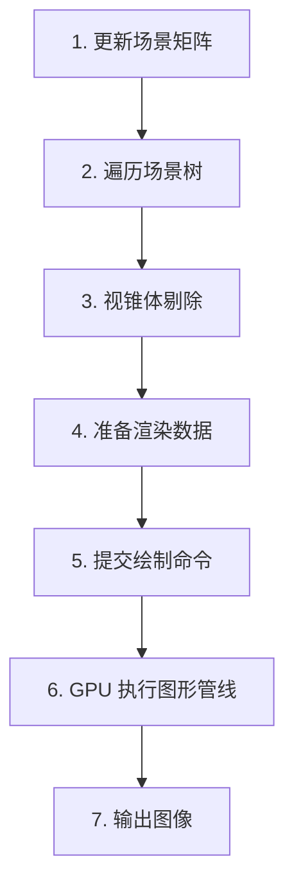

# D02：Three.js 渲染原理与场景树

> 从 Scene Graph 到 GPU：理解一个 3D 场景是如何被组织和绘制的

| 项目 | 说明 |
| --- | --- |
| 预计学习时间 | 30 分钟 |
| 课程类型 | 原理 + 编程实战 |
| 所属阶段 | 第 1 周 / 168 天 |
| 前置课程 | D01 认识 Three.js |
| 开发环境 | Vue 3 + TypeScript + Vite |

---

## 导读

D01 我们已经完成了第一个旋转立方体，并认识了 Scene、Camera、Renderer。

今天进一步回答一个非常关键的问题：

**当你执行 `renderer.render(scene, camera)` 时，Three.js 内部究竟做了什么？**

这节课会建立两个长期非常重要的认知：

1. Three.js 使用场景树（Scene Graph）组织三维世界。
2. Three.js 通过一系列变换和渲染流程，把场景中的三维物体变成屏幕上的像素。

这两个知识点会贯穿后面所有的数字孪生开发。

---

## 1. 学习目标

今天完成后，你应该能够：

- 理解 Scene Graph（场景图）的概念
- 理解 Object3D、Group、Mesh 之间的关系
- 理解父子对象的局部坐标和世界坐标
- 理解 `renderer.render()` 的基本执行流程
- 理解 Three.js 如何筛选需要绘制的对象
- 理解 Draw Call 是什么，以及它为什么影响性能
- 使用 Group 组织一个简单的三维园区场景

---

## 2. 概念讲解：什么是 Scene Graph？

### 2.1 为什么需要场景树？

假设我们现在需要创建一个三维园区，里面有：

- 一块地面
- 10 栋建筑
- 20 棵树
- 5 辆汽车
- 若干道路和路灯

如果所有物体都直接添加到 Scene 中：

```js
scene.add(ground)
scene.add(building1)
scene.add(building2)
scene.add(tree1)
scene.add(tree2)
scene.add(car1)
scene.add(car2)
```

当物体数量越来越多时，管理就会变得困难。例如：

- 想移动整个园区怎么办？
- 想统一隐藏某个建筑群怎么办？
- 想让一辆汽车的车身和车轮一起移动怎么办？
- 想让一个模型整体旋转怎么办？

这时就需要 Scene Graph。

**Scene Graph 是一种通过树形层级关系组织三维对象的结构。**

例如：

```text
Scene
│
├── Ground
│
├── BuildingGroup
│   ├── Building_A
│   ├── Building_B
│   └── Building_C
│
├── TreeGroup
│   ├── Tree_01
│   ├── Tree_02
│   └── Tree_03
│
└── VehicleGroup
    ├── Car_01
    └── Car_02
```

这里有一个非常重要的特点：**父对象可以统一控制所有子对象。**

例如：

```js
const buildingGroup = new THREE.Group()

buildingGroup.add(buildingA)
buildingGroup.add(buildingB)
buildingGroup.add(buildingC)

scene.add(buildingGroup)

// 整个建筑群一起移动
buildingGroup.position.x = 10
```

三个建筑都会随着父对象一起移动。这就是层级结构的价值。

### 2.2 Object3D 是什么？

在 Three.js 中，`Object3D` 是非常重要的基础类。很多常用对象都继承自它，例如：

- Scene
- Group
- Mesh
- PerspectiveCamera
- OrthographicCamera
- DirectionalLight
- PointLight

可以把它理解为：

**Object3D 提供了三维对象最基础的空间属性和层级管理能力。**

例如：

```js
object.position
object.rotation
object.scale
object.quaternion
object.matrix
object.matrixWorld
```

这些属性和方法是后面学习 3D 数学的重要基础。

### 2.3 Group 和 Mesh 有什么区别？

| 类型 | 定位 |
| --- | --- |
| Group | 用于组织对象，通常不直接绘制可见几何体 |
| Mesh | 由几何体和材质组成，可以参与实际绘制 |

对比一下：

| 属性 | Group | Mesh |
| --- | --- | --- |
| 继承 Object3D | 是 | 是 |
| 可以有子对象 | 是 | 是 |
| 可以移动旋转缩放 | 是 | 是 |
| 自带几何体 | 否 | 是 |
| 自带材质 | 否 | 是 |
| 通常产生绘制调用 | 否 | 是 |

注意：Mesh 也可以拥有子对象，并不意味着只有 Group 才能建立层级结构。

不过在工程实践中，我们通常使用 Group 表达业务层级，让场景结构更清晰。

---

## 3. 底层原理：父子对象与坐标变换

这是今天最重要的知识点。

你之前已经使用过：

```js
cube.position.set(1, 0, 0)
```

但你可能还没有深入理解：这个位置到底是相对于谁而言的？

答案是：

**`position` 默认表示相对于父对象的局部坐标（Local Position）。**

### 3.1 局部坐标与世界坐标

假设有一个父对象：

```js
const group = new THREE.Group()
group.position.set(10, 0, 0)
```

然后在这个 Group 中创建一个立方体：

```js
const cube = new THREE.Mesh(
  new THREE.BoxGeometry(1, 1, 1),
  new THREE.MeshBasicMaterial({ color: 0x00aaff })
)

cube.position.set(2, 0, 0)

group.add(cube)
scene.add(group)
```

此时：

- Group 在世界 X 轴位置为 `10`
- Cube 在 Group 的局部 X 轴位置为 `2`

因此，在没有其他旋转和缩放影响时：

```text
父对象世界位置 + 子对象局部位置 = 子对象世界位置
10 + 2 = 12
```

这就是局部坐标与世界坐标的区别。

### 3.2 如果父对象旋转了呢？

这时事情会变得更有意思。假设：

```js
group.rotation.z = Math.PI / 2
cube.position.set(2, 0, 0)
```

父对象绕 Z 轴旋转了 90 度。那么子对象原本沿着父对象局部 X 轴的偏移，也会跟着旋转。

结果是：

- 子对象局部坐标仍然是 `(2, 0, 0)`
- 子对象的世界坐标将不再是 `(12, 0, 0)`
- 它会出现在父对象旋转后的对应位置

这里就涉及矩阵变换。一个对象的世界矩阵可以理解为：

```text
M_world = M_parent × M_local
```

其中：

- `M_parent`：父对象的世界矩阵
- `M_local`：当前对象相对于父对象的局部矩阵
- `M_world`：当前对象最终的世界矩阵

对于更深的层级：

```text
M_world = M_0 × M_1 × M_2 × … × M_n
```

这就是为什么场景树不仅仅是一个管理对象的树，它还决定了对象的空间变换关系。

今天先理解原理即可，第 3 周我们会专门学习矩阵乘法、向量变换和四元数。

### 3.3 如何获取世界坐标？

Three.js 提供了：

```js
object.getWorldPosition(target)
```

例如：

```js
const worldPosition = new THREE.Vector3()

cube.getWorldPosition(worldPosition)

console.log(worldPosition)
```

它会将对象的世界位置写入传入的 `Vector3`，并返回这个 `Vector3`。

注意：如果你刚刚修改了对象的变换属性，而场景矩阵尚未更新，可以在需要时执行：

```js
scene.updateMatrixWorld(true)
```

或者：

```js
cube.updateWorldMatrix(true, false)
```

具体使用哪种方式，要看你希望更新哪个对象及其父子关系。

---

## 4. 底层原理：`renderer.render()` 到底做了什么？

现在进入第二个重点。我们平时写：

```js
renderer.render(scene, camera)
```

看起来只有一行代码，但背后包含了很多工作。

可以把它简化为以下流程：



1. **更新场景矩阵**：根据对象的位置、旋转、缩放和父子关系，更新相关变换矩阵
2. **遍历场景树**：找到场景中需要考虑的对象，例如 Mesh、Light 等
3. **视锥体剔除**：判断物体是否位于相机可见范围内，减少不必要的绘制工作
4. **准备渲染数据**：处理几何体、材质、纹理、光照、渲染状态等
5. **提交绘制命令**：将相关渲染工作提交到底层图形 API
6. **GPU 执行图形管线**：进行顶点处理、光栅化、片元处理和深度测试等工作
7. **输出图像**：最终形成可以显示在屏幕上的图像

这是一个帮助理解的简化流程，并不是 Three.js 内部所有函数的严格执行顺序。实际实现还涉及渲染列表、排序、阴影、Render Target 等处理。

### 4.1 什么是视锥体剔除？

假设你正在开发一个大型园区数字孪生项目。

场景中有 1000 栋建筑，但相机当前只看得到其中 30 栋。是否需要把 1000 栋建筑全部绘制？

没有必要。

Three.js 可以通过 **Frustum Culling（视锥体剔除）** 判断对象是否处于相机视野范围内。

相机视锥体可以理解成相机能够看到的一个空间区域。物体如果完全位于视锥体之外，就可以跳过相应的绘制工作。

Three.js 中，Mesh 默认启用了：

```js
mesh.frustumCulled = true
```

如果设置为：

```js
mesh.frustumCulled = false
```

就会关闭该对象的视锥体剔除。但不要随意关闭，特别是大型场景。

需要注意：视锥体剔除通常依赖对象的包围体进行判断。如果你自己修改了几何体顶点，却没有正确更新包围体，也可能造成错误剔除。

### 4.2 什么是 Draw Call？

这是今天另一个非常重要的概念。

**Draw Call 可以简单理解为：CPU 向 GPU 提交一次绘制命令。**

例如：

```js
scene.add(mesh1)
scene.add(mesh2)
scene.add(mesh3)
```

如果这三个 Mesh 都可见、使用不同的独立绘制对象，且没有触发合批或实例化等优化，那么它们通常需要多次绘制调用。

假设：

| 场景 | Mesh 数量 | 粗略绘制调用 |
| --- | --- | --- |
| 场景 A | 10 | 约 10 |
| 场景 B | 100 | 约 100 |
| 场景 C | 1000 | 约 1000 |

这是为了说明问题的简化示例，不是严格的一一对应关系。

因为实际 Draw Call 还会受到以下因素影响：

- 材质数量
- 几何体数量
- 渲染 Pass
- 阴影
- 后期处理
- 对象是否被剔除
- 是否使用 `InstancedMesh`
- 是否进行了合批

为什么 Draw Call 太多会影响性能？

因为每次绘制调用都可能需要 CPU 准备和提交渲染状态。大量 Draw Call 会增加 CPU 端的渲染管理开销。

后面第 16 周，我们会专门学习 `InstancedMesh`、`BatchedMesh` 和 Draw Call 优化。

---

## 5. 核心 API：今天必须掌握的接口

以下 API 以 Three.js 当前主流 `WebGLRenderer` / `Object3D` API 为基础。

| API | 作用 | 返回值 |
| --- | --- | --- |
| `new THREE.Group()` | 创建分组对象 | Group |
| `group.add(object)` | 添加子对象 | Group |
| `group.remove(object)` | 移除子对象 | Group |
| `object.parent` | 获取父对象 | Object3D 或 null |
| `object.children` | 获取直接子对象 | Object3D[] |
| `object.traverse(callback)` | 遍历自身及后代 | void |
| `object.getWorldPosition(target)` | 获取世界位置 | Vector3 |
| `object.localToWorld(vector)` | 局部坐标转世界坐标 | Vector3 |
| `object.worldToLocal(vector)` | 世界坐标转局部坐标 | Vector3 |
| `object.updateMatrixWorld(force)` | 更新世界矩阵 | void |
| `renderer.render(scene, camera)` | 渲染场景 | void |

### 5.1 `Group.add()`

```js
group.add(mesh)
```

把对象添加为 Group 的子对象。

如果对象原本属于其他父对象，它会从原父对象移除，再加入新的父对象。

### 5.2 `traverse()`

```js
scene.traverse((object) => {
  console.log(object.name)
})
```

递归遍历对象及其后代。这在大型项目中非常有用，例如：

- 批量修改建筑材质
- 找到所有 Mesh
- 统计场景对象数量
- 批量设置阴影属性

### 5.3 `getWorldPosition()`

```js
const position = new THREE.Vector3()
mesh.getWorldPosition(position)
```

返回对象在世界空间中的位置。

### 5.4 `localToWorld()`

```js
const point = new THREE.Vector3(1, 0, 0)
mesh.localToWorld(point)
```

将点从对象局部坐标转换为世界坐标。

注意：该方法会直接修改传入的 `Vector3`。

---

## 6. 实战：构建一个具有层级关系的数字孪生园区

今天我们不再只创建一个孤立的立方体。我们创建一个简化园区：

- 一个 Scene
- 一个 Ground
- 一个 BuildingGroup
- 三栋建筑
- 一个 VehicleGroup
- 一辆汽车
- 一个相机
- 一个渲染器

最终你会看到：建筑群可以整体移动，汽车也可以在自己的父级中独立移动。

### 6.1 完整代码

将下面代码放入 `src/App.vue`（或项目中对应的 Demo 组件）：

```vue
<script setup lang="ts">
import { onMounted, onBeforeUnmount, ref } from 'vue'
import * as THREE from 'three'

const container = ref<HTMLDivElement | null>(null)

let scene: THREE.Scene
let camera: THREE.PerspectiveCamera
let renderer: THREE.WebGLRenderer

let buildingGroup: THREE.Group
let vehicleGroup: THREE.Group

let animationId = 0

function createBuilding(
  x: number,
  z: number,
  height: number,
  color: number
): THREE.Mesh {
  const geometry = new THREE.BoxGeometry(2, height, 2)
  const material = new THREE.MeshBasicMaterial({ color })
  const building = new THREE.Mesh(geometry, material)

  building.position.set(x, height / 2, z)
  return building
}

function initThree(): void {
  if (!container.value) return

  const width = container.value.clientWidth
  const height = container.value.clientHeight

  // 1. 创建场景
  scene = new THREE.Scene()
  scene.background = new THREE.Color(0x17212b)

  // 2. 创建相机
  camera = new THREE.PerspectiveCamera(50, width / height, 0.1, 100)
  camera.position.set(12, 10, 16)
  camera.lookAt(0, 0, 0)

  // 3. 创建渲染器
  renderer = new THREE.WebGLRenderer({ antialias: true })
  renderer.setSize(width, height)
  renderer.setPixelRatio(Math.min(window.devicePixelRatio, 2))
  container.value.appendChild(renderer.domElement)

  // 4. 创建地面
  const groundGeometry = new THREE.BoxGeometry(20, 0.2, 20)
  const groundMaterial = new THREE.MeshBasicMaterial({ color: 0x34495e })
  const ground = new THREE.Mesh(groundGeometry, groundMaterial)
  ground.position.y = -0.1
  scene.add(ground)

  // 5. 创建建筑分组
  buildingGroup = new THREE.Group()
  buildingGroup.name = 'BuildingGroup'
  buildingGroup.add(
    createBuilding(-4, -3, 4, 0x3498db),
    createBuilding(0, -3, 7, 0x2ecc71),
    createBuilding(4, -3, 5, 0xe67e22)
  )
  scene.add(buildingGroup)

  // 6. 创建车辆分组
  vehicleGroup = new THREE.Group()
  vehicleGroup.name = 'VehicleGroup'

  const carBody = new THREE.Mesh(
    new THREE.BoxGeometry(2, 0.8, 1),
    new THREE.MeshBasicMaterial({ color: 0xff4757 })
  )
  carBody.position.y = 0.5
  vehicleGroup.add(carBody)
  vehicleGroup.position.set(0, 0, 3)
  scene.add(vehicleGroup)

  // 7. 创建辅助坐标轴
  const axes = new THREE.AxesHelper(5)
  scene.add(axes)

  // 8. 输出场景树信息
  console.log('Scene:', scene)
  console.log('Building parent:', buildingGroup.parent)
  console.log('Building children:', buildingGroup.children)

  // 9. 遍历整个场景
  scene.traverse((object) => {
    console.log('对象名称:', object.name, '对象类型:', object.type)
  })

  animate()
}

function animate(): void {
  animationId = requestAnimationFrame(animate)

  // 建筑群整体缓慢旋转
  buildingGroup.rotation.y += 0.002

  // 汽车沿 X 轴移动
  vehicleGroup.position.x = Math.sin(performance.now() * 0.001) * 4

  renderer.render(scene, camera)
}

function handleResize(): void {
  if (!container.value) return

  const width = container.value.clientWidth
  const height = container.value.clientHeight
  if (!width || !height) return

  camera.aspect = width / height
  camera.updateProjectionMatrix()
  renderer.setSize(width, height)
}

onMounted(() => {
  initThree()
  window.addEventListener('resize', handleResize)
})

onBeforeUnmount(() => {
  window.removeEventListener('resize', handleResize)
  cancelAnimationFrame(animationId)

  scene.traverse((object) => {
    if (object instanceof THREE.Mesh) {
      object.geometry.dispose()

      const materials = Array.isArray(object.material)
        ? object.material
        : [object.material]

      materials.forEach((material) => material.dispose())
    }
  })

  renderer.dispose()
  renderer.domElement.remove()
})
</script>

<template>
  <div ref="container" class="three-container"></div>
</template>

<style scoped>
.three-container {
  width: 100%;
  height: 500px;
  overflow: hidden;
}

.three-container :deep(canvas) {
  display: block;
  width: 100%;
  height: 100%;
}
</style>
```

### 6.2 逐段代码解析

#### 1）创建建筑工厂函数

```ts
function createBuilding(
  x: number,
  z: number,
  height: number,
  color: number
): THREE.Mesh
```

我们把建筑创建逻辑封装成函数。这样以后创建 100 栋建筑时，就不需要重复写 Geometry、Material 和 Mesh。

```js
building.position.set(x, height / 2, z)
```

为什么 Y 轴位置是 `height / 2`？

因为 `BoxGeometry` 默认以自身中心为原点。如果建筑高度为 4，那么它默认占据：

- 最低 Y = `-2`
- 最高 Y = `2`

将它向上移动 2 个单位后，底部就正好位于地面 Y = 0。

这是一种非常常见的三维建模技巧。

#### 2）创建 BuildingGroup

```js
buildingGroup = new THREE.Group()

buildingGroup.add(
  createBuilding(-4, -3, 4, 0x3498db),
  createBuilding(0, -3, 7, 0x2ecc71),
  createBuilding(4, -3, 5, 0xe67e22)
)

scene.add(buildingGroup)
```

这里创建了三栋建筑，它们全部属于 BuildingGroup。所以只要执行：

```js
buildingGroup.position.x = 5
```

整个建筑群都会一起向右移动。

#### 3）创建 VehicleGroup

汽车也被放在单独的 Group 中。

```js
vehicleGroup.position.set(0, 0, 3)
```

这里设置的是车辆分组的位置。

未来如果汽车包含车身、四个车轮、车灯、车窗、车牌，就可以全部作为子对象添加进去。当车辆移动时，所有部件都会一起移动。

这就是数字孪生平台中组织车辆模型的基本方式。

#### 4）遍历场景树

```js
scene.traverse((object) => {
  console.log(object.name, object.type)
})
```

这个方法非常值得记住。未来加载 GLB 模型时，我们经常需要遍历整个模型层级。例如：

```js
model.traverse((object) => {
  if (object instanceof THREE.Mesh) {
    object.castShadow = true
    object.receiveShadow = true
  }
})
```

可以批量设置模型的阴影属性。

#### 5）销毁资源

```js
object.geometry.dispose()
material.dispose()
renderer.dispose()
```

这是工程化开发必须养成的习惯。

特别是 Three.js 的 Geometry、Material 和 Texture 等资源，不能简单认为删除 Mesh 就会自动释放所有 GPU 资源。

今天的示例没有使用 Texture，但以后加载复杂模型时，也需要管理纹理和其他资源。

---

## 7. 常见问题与误区

### 问题一：Group 和 Scene 有什么区别？

两者都继承 Object3D，都可以管理子对象。

但 Scene 是场景根节点，通常承载整个世界。Group 是普通分组节点，通常用于组织业务对象。

```text
Scene
 ├── Group A
 │    ├── Mesh 1
 │    └── Mesh 2
 │
 └── Group B
      ├── Mesh 3
      └── Mesh 4
```

### 问题二：修改父对象的位置，子对象会改变 position 吗？

不会。例如：

```js
group.position.x = 10
cube.position.x = 2
```

即使父对象移动了，`cube.position.x` 仍然是 `2`。

改变的是它的世界位置，而不是局部 `position` 属性。

### 问题三：为什么一个 Mesh 不一定只对应一个 Draw Call？

因为渲染还涉及材质组、多个渲染 Pass、阴影和其他渲染状态。

不能简单用 Mesh 数量等同于 Draw Call 数量。

### 问题四：为什么场景中看不到的物体还会占用资源？

视锥体剔除只是减少绘制工作，并不代表对象从内存中消失。

模型依然可能占用：

- JavaScript 内存
- GPU 显存
- 几何体缓冲区
- 纹理资源

如果场景规模很大，还需要使用 LOD、资源卸载、分块加载等策略。

### 问题五：是不是所有物体都应该放进 Group？

不需要。

如果对象之间没有明确的层级关系，直接添加到 Scene 也完全合理。

Group 的价值是表达组织关系，而不是为了增加层级而增加层级。

---

## 8. 今日课后练习

今天需要完成三个任务。

### 8.1 练习 A：场景树组织

在今天的园区代码中：

- 新建 `RoadGroup`
- 创建至少两条道路
- 将道路加入 `RoadGroup`
- 将 `RoadGroup` 加入 Scene
- 使用 `traverse()` 输出所有 Mesh 的名称

### 8.2 练习 B：父子坐标变换

请完成以下代码：

```js
const parent = new THREE.Group()
parent.position.set(10, 0, 0)

const child = new THREE.Mesh(
  new THREE.BoxGeometry(1, 1, 1),
  new THREE.MeshBasicMaterial()
)

child.position.set(2, 0, 0)

parent.add(child)
scene.add(parent)

const worldPosition = new THREE.Vector3()
child.getWorldPosition(worldPosition)

console.log(worldPosition)
```

回答：

1. `child.position.x` 是多少？
2. `worldPosition.x` 是多少？
3. 如果 `parent.position.x` 改成 `20`，`child.position.x` 会不会改变？
4. 如果父对象绕 Z 轴旋转 90 度，子对象的世界坐标会发生什么变化？

### 8.3 练习 C：理解渲染性能

请思考：如果一个园区中有 1000 栋建筑，每栋建筑都使用独立 Mesh，可能会出现哪些性能问题？

你可以从以下几个角度回答：

- CPU
- GPU
- Draw Call
- 内存
- 场景组织

---

## 9. D02 验收清单

完成 D02，需要满足：

- 理解 Scene Graph 的树形结构
- 理解 Object3D、Group、Mesh 的关系
- 能够创建父子对象层级
- 理解局部坐标与世界坐标
- 能够使用 `getWorldPosition()`
- 能够使用 `traverse()` 遍历场景
- 理解 `renderer.render()` 的基本流程
- 理解 Frustum Culling 和 Draw Call
- 成功运行园区层级场景 Demo

---

## 10. 今日知识小测

共 5 道题。

### 1. Three.js 中 Group 的主要作用是什么？

- A. 负责 GPU 渲染
- B. 组织和管理子对象
- C. 生成几何体

### 2. 父对象 `position.x = 10`，子对象 `position.x = 2`，且没有旋转和缩放，子对象世界 X 坐标是多少？

- A. 2
- B. 10
- C. 12

### 3. 修改父对象的位置后，子对象的 `position` 属性会怎样？

- A. 自动改变
- B. 保持原来的局部坐标
- C. 变成世界坐标

### 4. `scene.traverse()` 的主要作用是什么？

- A. 递归遍历场景对象
- B. 启动动画
- C. 释放 GPU 资源

### 5. Draw Call 主要代表什么？

- A. 创建一个 Mesh
- B. CPU 向 GPU 提交一次绘制命令
- C. 一个场景节点

请提交答案。

---

## 11. 今日课程总结

今天真正需要掌握的不是某几个 API，而是三个底层概念：

| 核心概念 | 需要形成的认知 |
| --- | --- |
| Scene Graph | 三维对象通过父子层级组织 |
| Matrix Transformation | 父子关系决定局部变换如何组合成世界变换 |
| Rendering Pipeline | 场景经过变换、筛选和绘制，最终形成屏幕图像 |

对未来数字孪生项目，我有一个明确建议：**从现在开始就养成按业务实体组织 Scene Graph 的习惯。**

例如：

```text
Scene
├── EnvironmentGroup
├── BuildingGroup
├── RoadGroup
├── EquipmentGroup
├── VehicleGroup
├── PersonnelGroup
└── EffectGroup
```

未来你接入实时人员 SSE 数据、设备状态、建筑信息和模型动画时，这种架构会比把所有 Mesh 平铺到 Scene 中更容易维护。

---

## 下一课预告

下一节 **D03：Three.js 项目初始化与开发环境**。

我们将正式建立自己的 Three.js 学习工程，深入理解：

- Three.js npm 包结构
- Vite 与 Three.js 的协作
- WebGLRenderer 初始化
- Canvas 与 WebGL 上下文
- Vue 生命周期与 Three.js 初始化
- 项目目录结构与基础封装

完成练习后，把代码、坐标题答案和小测结果发给我，我会先批改，再继续巩固后续内容。
